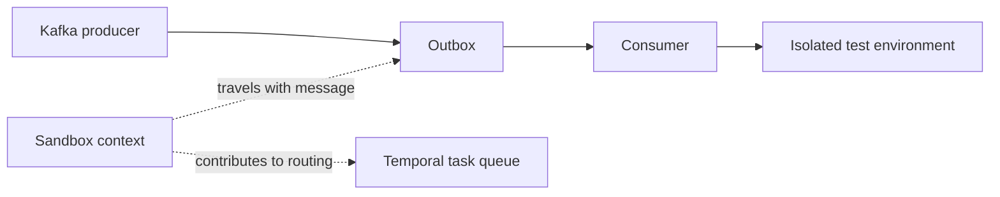
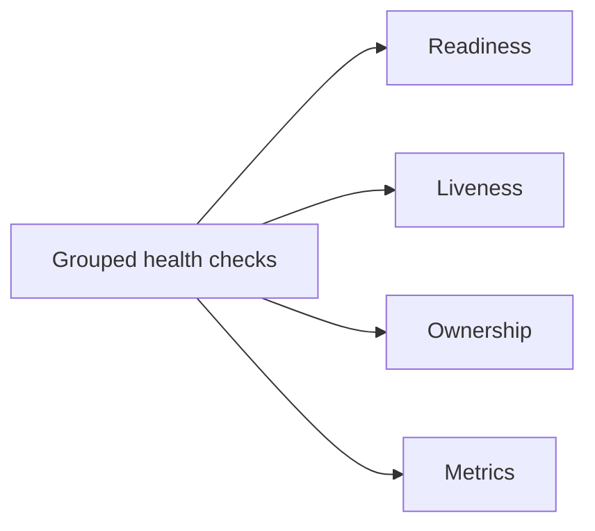
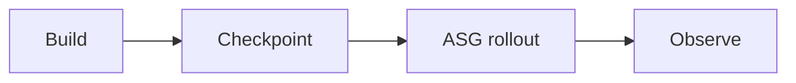
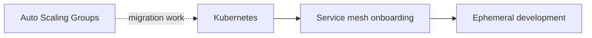
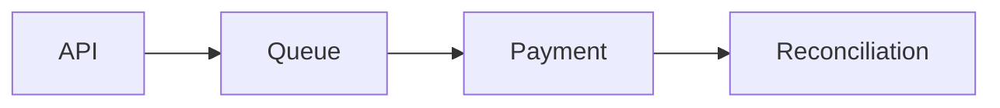
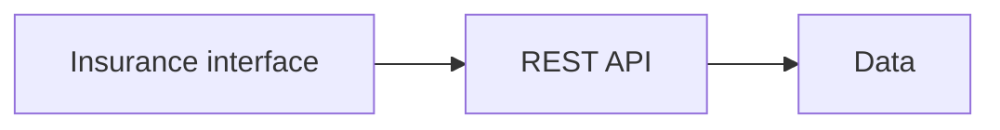

# Portfolio illustration concepts

The site uses original SVG illustrations based on these high-level diagrams. They describe the selected work without exposing internal architecture or source links.

